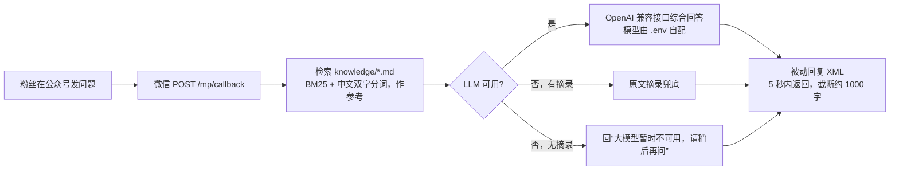

# 公众号轻量 RAG 机器人 v1.1

粉丝在公众号对话框发问题，机器人检索知识库作参考、调大模型综合回答，5 秒内用被动回复发回去。

知识范围：网络、通信工程、Docker、Kubernetes、云原生。种子知识库自带 7 篇文档，通俗深度，不写考试级内容。**大模型是主力，知识库只是参考**：知识库里没有的话题也能问，大模型用通用知识回答。

## 它是什么

轻量自研方案，不用向量数据库、不用 embedding 模型：



- 回答流程：检索 → 有相关摘录就当参考发给大模型，没有摘录大模型照常回答；**绝不因为“知识库里没有”就拒绝回答**。
- 模型不固定：`LLM_API_BASE` / `LLM_API_KEY` / `LLM_MODEL` 全在 `.env` 里配，改完 `docker compose restart` 即可，不用改代码、不用重新打镜像。见下面“换大模型”。
- 兜底：LLM 超时（默认 4 秒）、报错、未配置 Key 时，有摘录就返回知识库原文摘录，没摘录就回一句短的“大模型暂时不可用，请稍后再问”，不返回 traceback。
- 速度：系统提示词要求简短精炼，回答截断到约 1000 字，配合 4 秒超时，尽量在 5 秒内回完。
- 日志：只记问题长度和命中来源，不记完整 OpenID（只记前 8 位哈希）。

## 能做什么（v1.1）

| 粉丝发什么 | 结果 |
| --- | --- |
| Docker 网络模式有哪些？/ K8s Service 是什么？/ 光纤熔接要注意什么？等 | 检索作参考 + 大模型综合回答，有摘录时末尾附来源文件名 |
| 知识库里没有的话题，例如“Rust 怎么学”“NAS 怎么选” | 大模型用通用知识直接回答，不回“知识库里没有” |
| 帮助 / 菜单 / help | 示例问题菜单 |
| 大模型暂时不可用，且知识库有相关摘录 | 回知识库原文摘录 |
| 大模型暂时不可用，且知识库也没有相关内容 | 回“大模型暂时不可用，请稍后再问” |
| 图片、语音等非文本消息 | 忽略，回空串 |

## 未认证服务号的限制（先说清楚）

这个号是**服务号，未微信认证**，v1.1 按这个前提做，只做能做的事：

- **只有 5 秒内被动回复**：粉丝发消息后必须 5 秒内回完，超时粉丝就收不到。所以回答截断到约 1000 字、LLM 超时默认 4 秒，**选快模型（如 deepseek-chat / qwen-turbo 类）更容易在 5 秒内回完；慢的大模型容易超时收不到回复**。
- **没有 48 小时客服消息**：未认证不能用客服消息接口，v1.1 也没接，`MP_APPID` / `MP_APPSECRET` 不用配。回答只能在粉丝发消息后的 5 秒内被动回。
- **服务器配置启用后，自定义菜单不可用**：未认证服务号在启用服务器配置期间不能用自定义菜单，所以 v1.1 没有菜单功能，粉丝直接发文字问题就行；“菜单”命令只回帮助文字。
- **只支持明文模式**：公众号服务器配置必须选明文模式，安全模式 / 兼容模式暂不支持。

**可选的后续升级（不是必需）**：微信认证（300 元/年）后，才能用客服消息突破 5 秒、才能用自定义菜单；到时再接客服消息接口和菜单，现在不用管。

## 部署（NAS 上只留 compose + .env + knowledge/ + data/）

镜像由 GitHub Actions 在每次 push 到 main 后自动构建并推到 `ghcr.io/wdw6733/mp-rag-bot:latest`，NAS 上不用放源码、不用 build。

```bash
# 1. 在 NAS 上建目录，例如 /mnt/Strongge/docker-compose/mp-rag-bot/
#    把仓库里的 docker-compose.yml、.env.example、knowledge/ 拷进去
#    注意：compose 把 ./knowledge 只读挂载进容器，会覆盖镜像内置的 7 篇文档，
#    所以首次部署前必须先把 knowledge/ 下的 7 篇 .md 拷进 NAS 的 knowledge/ 目录。

# 2. 配凭证（不要提交到 GitHub）
cp .env.example .env
nano .env
#    MP_TOKEN：公众号后台服务器配置里的 Token，必须和后台填的一致
#    LLM_API_KEY：AnyRouter 的 Key
#    ADMIN_TOKEN：POST /admin/reload 的鉴权，随便填一个长随机字符串
#    LLM_MODEL 想换模型只改这一行，例如 muse-spark（以 AnyRouter 上实际有的模型为准）

# 3. 启动（重启即升级：compose 里 pull_policy: always，每次 up -d 都会先拉最新镜像，不用单独 pull）
docker compose down && docker compose up -d

# 4. 看日志，确认起来了
docker compose logs -f mp-rag-bot
# 应该看到：公众号 RAG 机器人 v1.1.0 启动：监听 0.0.0.0:18790，知识库 {'docs': 7, ...}

# 5. 检查健康接口
curl http://127.0.0.1:18790/health
# {"status":"ok","version":"1.1.0","docs":7,"chunks":...}
```

## 公众号后台配置

微信公众平台 → 设置与开发 → 基本配置 → 服务器配置：

- 服务器地址（URL）：`https://<你的域名>/mp/callback`（域名经反代指向 NAS 的 18790 端口，例如 Lucky 反代；URL 里不需要写端口）
- 令牌（Token）：和 `.env` 里的 `MP_TOKEN` 填同一个值
- 消息加解密方式：选**明文模式**（v1 只支持明文；安全模式需要加解密，以后版本再加）
- 点“提交”：后台会发 GET 验证请求，服务验签通过后原样返回 echostr，验证即通过

验证通过后把服务器配置启用，粉丝发消息就会 POST 到这个服务。

## 加一篇新知识

不用重新拉镜像、不用重启容器：

```bash
# 1. 把新的 .md 文件放进 NAS 的 knowledge/ 目录
#    格式：H1 是文档标题，H2/H3 是章节，结构建议按
#    是干什么的 / 怎么工作 / 动手例子 / 常见坑 来写
# 2. 调重建接口
curl -X POST http://127.0.0.1:18790/admin/reload -H "X-Admin-Token: <ADMIN_TOKEN>"
# 返回 {"status":"ok","docs":8,"chunks":...} 就是生效了
```

也可以直接在公众号里问新文档里的问题验证。

## 换大模型（模型不固定，由你自己配）

只改 `.env` 里的几行再重启容器，**不用改代码、不用重新打镜像**：

```bash
LLM_API_BASE=https://anyrouter.top/v1
LLM_API_KEY=<你的 Key>
LLM_MODEL=muse-spark
LLM_TIMEOUT_SEC=4
LLM_MAX_TOKENS=800
docker compose restart
```

- `LLM_API_BASE`：OpenAI 兼容接口地址，AnyRouter、AgentRouter、官方地址都行，填哪个就走哪个。
- `LLM_API_KEY`：对应上面地址的 Key。
- `LLM_MODEL`：模型名，留空时默认 `deepseek-chat`，建议明确填一个；例子：`deepseek-chat` / `muse-spark` / `gpt-4o` / `qwen-turbo`（以你用的网关上实际有的模型为准，服务不校验模型名）。
- `LLM_TIMEOUT_SEC`：超时，默认 4 秒；`LLM_MAX_TOKENS`：单次回答上限，默认 800。
- `LLM_SYSTEM_PROMPT`：可选，覆盖默认系统提示词（默认：中文、通俗深度、简短精炼 1000 字内、不编造）。

注意 5 秒红线：选快模型更容易在 5 秒内回完；慢的大模型容易超时，粉丝收不到回复，调不通时服务会走摘录兜底并在日志里记一条失败。

## v1.1 的限制（先说清楚）

- **只支持明文模式**：公众号服务器配置必须选明文模式，安全模式 / 兼容模式暂不支持。
- **只支持被动回复**：未认证服务号没有客服消息，粉丝发消息后 5 秒内必须回完，回答截断到约 1000 字。
- **检索是关键词 BM25，不是语义向量**：问法和文档用词差太远时可能搜不到相关摘录，但 v1.1 里搜不到也不拦路，大模型照常用通用知识回答；以后量大了再考虑向量库。
- **没有多轮对话**：每条消息独立检索回答，不记上下文。
- **没有自定义菜单**：未认证服务号在服务器配置启用期间不能用自定义菜单，粉丝直接发文字问题。

## 本地开发与测试

```bash
python3 -m venv .venv && .venv/bin/pip install -r requirements.txt
.venv/bin/python -m pytest tests/ -v
# 48 个测试：分词、分块、检索、签名、XML 解析、LLM 成功/无匹配照常回答/
# 失败兜底（有摘录回摘录、无摘录回短提示）、模型可配置、1000 字截断、
# 健康接口、URL 验证、文本/非文本/坏 XML 回调、管理重建鉴权

# 本地启动（不连微信、不调真实 LLM 也能跑；LLM 未配 Key 时有摘录走摘录兜底，
# 无摘录回“大模型暂时不可用，请稍后再问”）
MP_TOKEN=test LLM_API_KEY= ADMIN_TOKEN=admin .venv/bin/python mp_rag_bot.py
curl http://127.0.0.1:18790/health
```

## 文件结构

```
mp-rag-bot/
├── mp_rag_bot.py            # Flask 应用：微信回调、问答流程、健康/重建接口
├── retrieval.py             # 检索：Markdown 分块 + BM25（纯标准库）
├── knowledge/               # 种子知识库，7 篇
│   ├── 01-network-tcpip.md
│   ├── 02-communication-fiber-cabling.md
│   ├── 03-docker-basics.md
│   ├── 04-docker-network.md
│   ├── 05-kubernetes-core.md
│   ├── 06-kubernetes-network-service.md
│   └── 07-cloud-native-overview.md
├── tests/test_mp_rag_bot.py # pytest，48 个测试
├── requirements.txt         # flask、requests
├── Dockerfile               # python:3.12-slim
├── docker-compose.yml       # 拉 ghcr.io/wdw6733/mp-rag-bot:latest
├── .env.example             # 配置模板，无真实凭证
└── .github/workflows/docker-publish.yml
```
