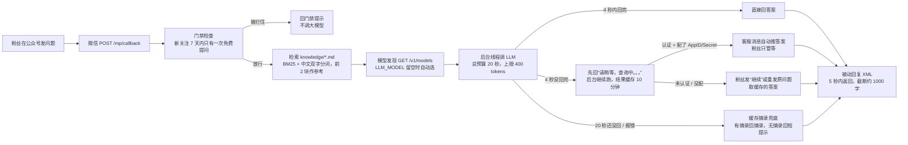

# 公众号轻量 RAG 机器人 v1.4.1

粉丝在公众号对话框发问题，机器人检索知识库作参考、调大模型综合回答，正常 4 秒内直接回答案，不用粉丝再发“继续”。大模型慢的时候先回一句“请稍等，查询中。。。”，后台继续查到 20 秒：认证过的号会自动把答案推给粉丝，没认证的号粉丝发“继续”取答案（见下面“异步查询”和“不用再发‘继续’”）。

v1.4 的两件大事：**大多数问题直接回**（回答更短、检索更少，回得更快）；**新关注用户门禁**（刚关注 7 天内只能免费问一次，满 7 天自动解锁，见下面“新关注门禁”）。

知识范围：网络、通信工程、Docker、Kubernetes、云原生。种子知识库自带 7 篇文档，通俗深度，不写考试级内容。**大模型是主力，知识库只是参考**：知识库里没有的话题也能问，大模型用通用知识回答。

## 它是什么

轻量自研方案，不用向量数据库、不用 embedding 模型：



- 回答流程：门禁 → 检索（前 2 块）→ 模型发现/自动选 → 有相关摘录就当参考发给大模型，没有摘录大模型照常回答；**绝不因为“知识库里没有”就拒绝回答**。
- 模型不固定：`LLM_API_BASE` / `LLM_API_KEY` / `LLM_MODEL` 全在 `.env` 里配，改完 `docker compose restart` 即可，不用改代码、不用重新打镜像。见下面“模型自动选择”和“换大模型”。
- 兜底：LLM 在总预算（默认 20 秒）内没回、报错、未配置 Key 时，有摘录就返回知识库原文摘录，没摘录就回一句短的“大模型暂时不可用，请稍后再问”，不返回 traceback。
- 速度：v1.4 回答上限默认 400 tokens、检索只取前 2 块、每块上下文截到 800 字，提示词更小，大多数问题 4 秒内直接回完；大模型慢时走异步流程，见下面“异步查询”。
- 日志：只记问题长度和命中来源，不记完整 OpenID（只记前 8 位哈希）。

## 能做什么（v1.4）

| 粉丝发什么 | 结果 |
| --- | --- |
| Docker 网络模式有哪些？/ K8s Service 是什么？/ 光纤熔接要注意什么？等 | 检索作参考 + 大模型综合回答，有摘录时末尾附来源文件名 |
| 知识库里没有的话题，例如“Rust 怎么学”“NAS 怎么选” | 大模型用通用知识直接回答，不回“知识库里没有” |
| 帮助 / 菜单 / help | 示例问题菜单 |
| 刚关注，第一次提问 | 免费回答（快就直接回，慢就先回“请稍等，查询中。。。”） |
| 刚关注不满 7 天，第二次提问 | 回门禁提示，不调大模型（见“新关注门禁”） |
| 大模型慢，4 秒没回完 | 先回“请稍等，查询中。。。”，后台继续查；认证过的号自动推答案，没认证的号发“继续”或重发原问题取答案 |
| 大模型 20 秒还没回 / 报错，且知识库有相关摘录 | 自动推或发“继续”拿到知识库原文摘录 |
| 大模型 20 秒还没回 / 报错，且知识库也没有相关内容 | 自动推或发“继续”拿到“大模型暂时不可用，请稍后再问” |
| 关注 / 取关 | 关注回欢迎语并开始计时 7 天；取关只记一笔，不删记录 |
| 图片、语音等非文本消息 | 忽略，回空串 |

## 异步查询（v1.3 新增）

**先说清楚一个硬限制：微信被动回复必须在粉丝发消息后 5 秒内到，超时粉丝就什么都收不到。** 这个号是个人、未认证的订阅号，没有客服消息，机器人不能在 20 秒后主动再推一条消息过去。所以“等 20 秒再直接回答案”是不可能的——那样答案永远发不出去，只会更糟。未认证的号上，v1.4 用的还是这个号能做到的办法：**先回一行占位提示“请稍等，查询中。。。”**（v1.4.1 起占位只有这一行，不再写“稍后发‘继续’查看结果”）；认证并配好 AppID/Secret 后才能自动推（见“不用再发‘继续’”）。没认证的号上，粉丝发“继续”或重发原问题仍能拿到缓存的答案——只是占位里不再提示这一步。

实际对话是这样的：

```
粉丝：Docker 网络模式有哪些？
机器人：请稍等，查询中。。。
        ← 大模型 4 秒没回完时才这样回；4 秒内回完的直接就是答案
粉丝：继续
机器人：bridge 是默认模式，……（完整答案 + 来源）
```

规则：

- **快路径不变**：大模型 4 秒内回完，直接回答案，和以前一样，粉丝什么都不用多做。
- **慢路径**：4 秒没回完，先回占位提示，后台继续跑到 20 秒，结果缓存在内存里 10 分钟。粉丝发“继续”/“继续查询”/“好了吗”/“结果”/“查看结果”就能拿到；重发同样的问题也一样能拿到（还在跑时会回“还在查询，请再等一下”，不会重复开一个任务）。
- **取过一次就清除**：答案取走后任务就删了，再发“继续”只会回帮助菜单，不会重复发同一条答案。
- **问新问题会取代旧的**：没等到旧答案就问了新问题，旧任务作废（日志记一条“新问题取代旧查询”），只查新的。
- **20 秒还没回**：缓存的是摘录兜底（有摘录回摘录，无摘录回短提示），发“继续”拿到的是兜底结果，不是无限等下去。
- **缓存只在内存里**：不写文件、不建数据库，容器重启后缓存清空；每人同时只保留一个任务。Flask 开发服务器是单进程，这一点没有问题。
- **帮助命令不受影响**：“帮助”/“你好”这些任何时候都直接回帮助，不会触发查询、也不会打断正在跑的任务。

两个超时，调哪个要分清：

| 配置 | 默认 | 作用 | 能调多大 |
| --- | --- | --- | --- |
| `LLM_FIRST_WAIT_SEC` | 4 秒 | 主请求等后台的第一段等待 | **绝不能超过 4.5 秒**（代码会截断），否则占位提示本身都发不出去；想调就往小调 |
| `LLM_TIMEOUT_SEC` | 20 秒 | 后台大模型调用的总预算，v1.2 的自动换模型重试也都在这个总预算里 | 可以按网关速度调，20 秒是给慢网关（muse2api）留的；网关快的话调小也行 |

## v1.4：不用再发“继续”

正常就该是粉丝发消息、直接等答案，v1.3 的“继续”只是没办法的办法。v1.4 从两头解决：

**1. 大多数问题直接回。** 回答上限从 800 tokens 改成默认 400，检索只取前 2 块、每块上下文截到 800 字，提示词小了，大模型回得更快，4 秒内直接回答案的概率更高。粉丝什么都不用多做。

**2. 慢回答自动推（要认证）。** 微信认证（300 元/年）后，在 `.env` 里配上 `MP_APPID` / `MP_APPSECRET`，慢回答查完机器人直接用客服消息把答案推给粉丝。v1.4.1 起，占位提示在两种模式下都只有一行“请稍等，查询中。。。”，不再提“继续”。步骤：

1. 微信认证（300 元/年，公众号后台申请）。
2. 微信开发者平台 → 我的业务 → 公众号 → 基础信息，找到 AppID；同一页“开发密钥”里查看/重置 AppSecret。
3. NAS 的 `.env` 里填 `MP_APPID` / `MP_APPSECRET`，`docker compose down && docker compose up -d` 重启。
4. 启动日志看到 `客服推送=已开启`，`/health` 里 `push_enabled` 为 `true`，就是开了。

推送失败（比如号其实没认证，微信会报 `errcode 48001`）时机器人只记一条日志、不循环重试，答案照样缓存着，粉丝发“继续”还是能拿到——自动推是锦上添花，不是唯一出路。

**没认证、没配 AppID/Secret 时，“继续”还在。** 这不是机器人不想推，是微信不让未认证的号主动推消息。未认证的号上，慢回答还是先回“请稍等，查询中。。。”，粉丝发“继续”取答案。

## 新关注门禁（v1.4 新增）

刚关注的用户只能免费问一次，关注满一星期并转发 5 篇文章后才能正常用大模型问答。先把微信到底能查到什么说清楚，免得误会：

| 规则 | 微信给不给查 | 机器人怎么做 |
| --- | --- | --- |
| 刚关注 / 关注时间 | 能查：关注时微信会发 `subscribe` 事件过来 | 收到事件就记下关注时间，从那天起算 7 天；满 7 天自动解锁，不用定时任务 |
| 还没关注 | 不用查：没关注的人根本发不了消息 | 不存在“没关注还提问”的情况，不用拦 |
| 关注满一星期 | 能算：现在减去关注时间 ≥ 7 天 | 到时间自动解锁 |
| 转发 5 篇文章 | **查不到**：微信不给服务器发转发事件，也没有接口能查某个人转发了几篇 | **不自动数**。转发 5 篇是写在提示里的规则，靠信任；用户拿截图等凭证找管理员，管理员手动解锁 |

具体规则：

- 关注后第一次提问正常回答（快就直接回，慢就先回“请稍等，查询中。。。”，再用自动推或“继续”取）。
- 7 天内第二次提问起，不调大模型、不开异步任务，直接回：`新关注用户仅可免费提问一次。关注满一星期并转发5篇文章后，即可正常使用大模型问答。（你已关注X天，还差Y天）`
- “帮助”/“你好”不算提问，不拦；“继续”取第一次的答案不算提问，不拦。
- 取关再关注**不重置**：保留最早的关注时间和已有的提问次数，防止取关重关刷免费次数。
- 部署前就关注的老粉丝：机器人没收到过他们的关注事件，第一次提问时按那次提问时间起算 7 天（日志里会记一句说明），之后正常计时。
- 记录存在 `./data/usage.json`（容器里是挂载的 `/data/usage.json`，compose 已挂 `./data:/data`，重启、升级都不会丢），只记 openid 的前 8 位哈希，不存完整 openid。文件损坏时从空开始，不崩。

**管理员手动解锁**（给拿了转发凭证的用户提前解锁）：

```bash
curl -X POST http://127.0.0.1:18790/admin/unlock \
  -H "X-Admin-Token: <ADMIN_TOKEN>" \
  -H "Content-Type: application/json" \
  -d '{"openid": "<粉丝的 OpenID>"}'
# 返回 {"status":"ok","user":"<前8位哈希>","unlocked":true}
```

粉丝的 OpenID 从哪来：NAS 的容器日志里微信每次 POST 的那行就带 `openid=...`（例如 `POST /mp/callback?...&openid=ofx1EwDCSWcDfz0vnqJDo1e4evBo`），按时间找到那条消息就能取到；公众号后台的消息列表里点开用户也能看到。解锁后该用户永久不再受门禁限制。`/health` 里 `gated_users` 是当前还在 7 天门禁期内、未解锁的用户数。

## 模型自动选择（v1.2 新增）

**不要指定模型，留空让它自动选——这是推荐做法。** 不同网关的模型名不一样，硬编码一个名字换个网关就 400 报错：实测 wb（`http://192.168.124.251:8788/v1`）上 `deepseek-chat` 直接报上游 400、`code 11102 model [deepseek-chat] service info not found`；muse2api 上原生模型只有 `muse-spark` 等，`deepseek-chat` 只是个别名还跑得慢。

自动模式怎么工作：

1. `LLM_MODEL` 留空（默认）：启动时调一次 `GET {LLM_API_BASE}/models`（3 秒超时，列表缓存 10 分钟），按快/便宜优先顺序自动挑一个：`deepseek-chat` → `qwen-turbo` → `qwen-plus` → `gpt-4o-mini` → `gpt-4o` → `muse-spark` → `deepseek-reasoner`，取列表里第一个有的（大小写不敏感）；优先名单里一个都没有，就取第一个非 embedding/音视频模型（跳过名字里含 `embed` / `tts` / `whisper` / `image` / `video` / `audio` 的）。
2. 发现失败或列表为空时不崩溃：用优先名单盲试，实在没有就走摘录兜底。
3. 已配模型优先用：如果 `LLM_MODEL` 填了，先用填的；它报 400 模型不存在时，自动刷新模型列表、换下一个接着试，直到总预算用完。
4. **总预算**：`LLM_TIMEOUT_SEC`（默认 20 秒，v1.3 起）是全部尝试加起来的总预算，不是每次尝试的超时——每次尝试用剩余时间，超时即停；首答只等 `LLM_FIRST_WAIT_SEC`（默认 4 秒），等不到先回“请稍等，查询中。。。”，后台继续跑到总预算。
5. 启动日志和 `/health` 会告诉你当前模式：`LLM=auto(muse-spark)@<base>，models=12 discovered` 或 `LLM=deepseek-chat@<base>`；`/health` 返回 `llm_mode`（`auto` / `fixed`）和 `llm_model`（选中的模型或 `auto:unknown`）。

强制指定模型：`.env` 里填 `LLM_MODEL=<网关上实际有的名字>`，重启即可；它 400 时仍会自动换下一个，不会直接兜底。

## 未认证服务号的限制（先说清楚）

这个号是**个人、未微信认证的订阅号**，v1.4 按这个前提做，只做能做的事：

- **只有 5 秒内被动回复**：粉丝发消息后必须 5 秒内回完，超时粉丝就收不到。所以回答截断到约 1000 字、首答只等 4 秒，等不到就先回占位提示（见“异步查询”）；**选快模型（如 deepseek-chat / qwen-turbo 类）更容易在 5 秒内直接回完；慢的大模型走自动推或“继续”取结果，也能拿到答案**。
- **没有 48 小时客服消息**：未认证不能用客服消息接口，v1.4 虽然接了，但没认证、没配 `MP_APPID` / `MP_APPSECRET` 时推送是关着的，慢回答只能等粉丝发“继续”来取。认证后配上就能自动推（见“不用再发‘继续’”）。
- **服务器配置启用后，自定义菜单不可用**：未认证服务号在启用服务器配置期间不能用自定义菜单，所以 v1.4 没有菜单功能，粉丝直接发文字问题就行；“菜单”命令只回帮助文字。
- **只支持明文模式**：公众号服务器配置必须选明文模式，安全模式 / 兼容模式暂不支持。

**可选的后续升级（不是必需）**：微信认证（300 元/年）后，才能用客服消息突破 5 秒、才能用自定义菜单；客服消息 v1.4 已接，菜单还没接。

## 部署（NAS 上只留 compose + .env + knowledge/ + data/）

镜像由 GitHub Actions 在每次 push 到 main 后自动构建并推到 `ghcr.io/wdw6733/mp-rag-bot:latest`，NAS 上不用放源码、不用 build。

```bash
# 1. 在 NAS 上建目录，例如 /mnt/Strongge/docker-compose/mp-rag-bot/
#    把仓库里的 docker-compose.yml、.env.example、knowledge/ 拷进去
#    注意：compose 把 ./knowledge 只读挂载进容器，会覆盖镜像内置的 7 篇文档，
#    所以首次部署前必须先把 knowledge/ 下的 7 篇 .md 拷进 NAS 的 knowledge/ 目录。

# 2. 配凭证（不要提交到 GitHub）
cp .env.example .env
nano .env
#    MP_TOKEN：公众号后台服务器配置里的 Token，必须和后台填的一致
#    LLM_API_KEY：AnyRouter 的 Key
#    ADMIN_TOKEN：POST /admin/reload 的鉴权，随便填一个长随机字符串
#    LLM_MODEL 留空=自动选（推荐）；想强制指定再填，例如 muse-spark（以你用的网关上实际有的模型为准）

# 3. 启动（重启即升级：compose 里 pull_policy: always，每次 up -d 都会先拉最新镜像，不用单独 pull）
docker compose down && docker compose up -d

# 4. 看日志，确认起来了
docker compose logs -f mp-rag-bot
# 应该看到：公众号 RAG 机器人 v1.4.1 启动：监听 0.0.0.0:18790，知识库 {'docs': 7, ...}，LLM=auto(...)@...，models=... discovered，首答等待 4.0s，总预算 20s，上限 400 tokens，客服推送=未开启（未配 MP_APPID/MP_APPSECRET，慢回答需发“继续”取）

# 5. 检查健康接口
curl http://127.0.0.1:18790/health
# {"status":"ok","version":"1.4.1","docs":7,"chunks":...,"llm_mode":"auto","llm_model":"...","llm_timeout_sec":20,"llm_first_wait_sec":4.0,"llm_max_tokens":400,"push_enabled":false,"gating_enabled":true,"gated_users":0,"async_jobs":0}
```

## 公众号后台配置

微信公众平台 → 设置与开发 → 基本配置 → 服务器配置：

- 服务器地址（URL）：`https://<你的域名>/mp/callback`（域名经反代指向 NAS 的 18790 端口，例如 Lucky 反代；URL 里不需要写端口）
- 令牌（Token）：和 `.env` 里的 `MP_TOKEN` 填同一个值
- 消息加解密方式：选**明文模式**（v1 只支持明文；安全模式需要加解密，以后版本再加）
- 点“提交”：后台会发 GET 验证请求，服务验签通过后原样返回 echostr，验证即通过

验证通过后把服务器配置启用，粉丝发消息就会 POST 到这个服务。

## 加一篇新知识

不用重新拉镜像、不用重启容器：

```bash
# 1. 把新的 .md 文件放进 NAS 的 knowledge/ 目录
#    格式：H1 是文档标题，H2/H3 是章节，结构建议按
#    是干什么的 / 怎么工作 / 动手例子 / 常见坑 来写
# 2. 调重建接口
curl -X POST http://127.0.0.1:18790/admin/reload -H "X-Admin-Token: <ADMIN_TOKEN>"
# 返回 {"status":"ok","docs":8,"chunks":...} 就是生效了
```

也可以直接在公众号里问新文档里的问题验证。

## 换大模型（模型不固定，由你自己配）

只改 `.env` 里的几行再重启容器，**不用改代码、不用重新打镜像**：

```bash
LLM_API_BASE=https://anyrouter.top/v1
LLM_API_KEY=<你的 Key>
LLM_MODEL=muse-spark
LLM_TIMEOUT_SEC=20
LLM_FIRST_WAIT_SEC=4
LLM_MAX_TOKENS=400
docker compose restart
```

- `LLM_API_BASE`：OpenAI 兼容接口地址，AnyRouter、AgentRouter、官方地址都行，填哪个就走哪个。
- `LLM_API_KEY`：对应上面地址的 Key。
- `LLM_MODEL`：模型名，**留空=自动（推荐）**：启动时调 `/v1/models` 按快/便宜优先自动选；填了就优先用填的，400 模型不存在时自动换下一个。例子：`deepseek-chat` / `muse-spark` / `gpt-4o` / `qwen-turbo`（以你用的网关上实际有的模型为准）。
- `LLM_TIMEOUT_SEC`：后台总预算，默认 20 秒——**这是全部尝试的总预算**，不是每次的超时；`LLM_FIRST_WAIT_SEC`：首答等待，默认 4 秒，**绝不能超过 4.5 秒**；`LLM_MAX_TOKENS`：单次回答上限，默认 400（v1.4 从 800 改的）。
- `LLM_SYSTEM_PROMPT`：可选，覆盖默认系统提示词（默认：中文、通俗深度、简短精炼 1000 字内、不编造）。

注意 5 秒红线：首答只等 4 秒，等不到就先回占位提示；慢的大模型走“继续”取结果，粉丝一样能拿到答案，调不通时服务会走摘录兜底并在日志里记一条失败。

## v1.4 的限制（先说清楚）

- **只支持明文模式**：公众号服务器配置必须选明文模式，安全模式 / 兼容模式暂不支持。
- **未认证的号不能主动推答案**：粉丝发消息后 5 秒内必须回完（先回答案或占位提示），回答截断到约 1000 字；后台查完能不能主动推，取决于号有没有认证 + 配没配 `MP_APPID` / `MP_APPSECRET`，没认证时还是要粉丝发“继续”来取。
- **转发 5 篇查不到**：门禁里的“转发 5 篇文章”微信不给服务器数据，只能写在提示里靠信任 + 管理员手动解锁，机器人不会、也不能自动数转发。
- **检索是关键词 BM25，不是语义向量**：问法和文档用词差太远时可能搜不到相关摘录，但 v1.4 里搜不到也不拦路，大模型照常用通用知识回答；以后量大了再考虑向量库。
- **没有多轮对话**：每条消息独立检索回答，不记上下文（“继续”只是取上一次查询的结果，不是接着聊）。
- **没有自定义菜单**：未认证服务号在服务器配置启用期间不能用自定义菜单，粉丝直接发文字问题。

## 本地开发与测试

```bash
python3 -m venv .venv && .venv/bin/pip install -r requirements.txt
.venv/bin/python -m pytest tests/ -v
# 116 个测试：分词、分块、检索、签名、XML 解析、LLM 成功/无匹配照常回答/
# 失败兜底（有摘录回摘录、无摘录回短提示）、模型可配置、1000 字截断、
# 健康接口、URL 验证、文本/非文本/坏 XML 回调、管理重建鉴权，
# 外加 v1.2 自动选模型：模型发现解析/缓存、优先顺序、跳过 embedding、
# 已配模型 400 换下一个、非模型 400 与超时不重试、总预算、health 模式、启动日志
# 外加 v1.3 异步查询：占位提示、“继续”取结果、还在查询、重发不重复开任务、
# 后台超时缓存兜底、无任务回帮助、帮助不打断任务、TTL 过期、新问题取代旧任务、
# 多用户互不干扰、首答等待 4.5 秒截断、daemon 线程、health 异步任务数
# 外加 v1.4 直接回复加速（max_tokens 400、检索前 2 块、上下文截 800 字）与
# 客服推送（token 缓存、推送成功/48001 失败兜底、快路径不重复推、推送开关），
# 外加 v1.4 新关注门禁（关注事件计时与欢迎语、一次免费提问、7 天自动解锁、
# 管理员手动解锁、帮助与“继续”不算提问、取关重关不重置、损坏文件不崩）
# 外加 v1.4.1 占位提示改成只有一行“请稍等，查询中。。。”（两种模式下都不提“继续”，
# “继续”取缓存答案的机制仍在后台照常工作，只是不再写进占位提示里）

# 本地启动（不连微信、不调真实 LLM 也能跑；LLM 未配 Key 时有摘录走摘录兜底，
# 无摘录回“大模型暂时不可用，请稍后再问”）
MP_TOKEN=test LLM_API_KEY= ADMIN_TOKEN=admin .venv/bin/python mp_rag_bot.py
curl http://127.0.0.1:18790/health
```

## 文件结构

```
mp-rag-bot/
├── mp_rag_bot.py            # Flask 应用：微信回调、问答流程、健康/重建接口
├── retrieval.py             # 检索：Markdown 分块 + BM25（纯标准库）
├── knowledge/               # 种子知识库，7 篇
│   ├── 01-network-tcpip.md
│   ├── 02-communication-fiber-cabling.md
│   ├── 03-docker-basics.md
│   ├── 04-docker-network.md
│   ├── 05-kubernetes-core.md
│   ├── 06-kubernetes-network-service.md
│   └── 07-cloud-native-overview.md
├── tests/test_mp_rag_bot.py # pytest，116 个测试
├── requirements.txt         # flask、requests
├── Dockerfile               # python:3.12-slim
├── docker-compose.yml       # 拉 ghcr.io/wdw6733/mp-rag-bot:latest
├── .env.example             # 配置模板，无真实凭证
└── .github/workflows/docker-publish.yml
```
